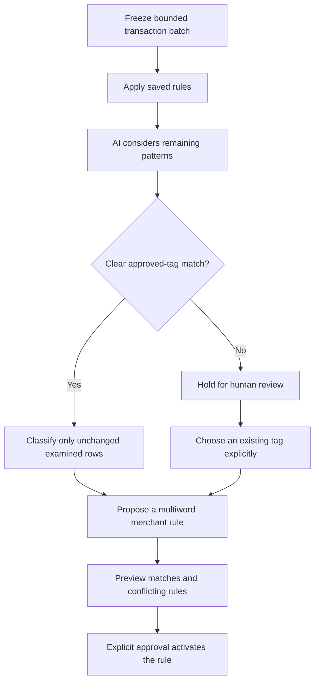

# Smart tagging

Tagging keeps a small vocabulary of reporting purposes. Merchant wording belongs in matching rules: Tesco, Aldi and Sainsbury’s can all point to Groceries. Create a separate tag only when it supports a distinct budget, report or decision.

## Run a pass

Open **Organise → Tagging → AI & automation** and select **Run smart tagging**. Configure the OpenAI API token in Settings first.

Each batch examines at most 250 untagged, non-transfer transactions. Saved rules run first. AI receives only the remaining patterns, their direction and amount examples, plus the complete approved tag catalogue with definitions, category context, recent examples and bounded alias examples. AI must treat bank wording as data and can return only existing tag IDs.

A clear decision needs at least **90% estimated confidence**, an explicit non-ambiguous result and an evidence-based reason. The estimate is supplied by the model; it is not a measured accuracy score. Generic marketplace or payment-processor wording should remain uncertain unless there is evidence of purchase purpose.

The run advances by transaction ID through the ledger as it existed when the run started. Unresolved early patterns cannot crowd out later transactions. New imports wait for a new pass. Stop and continue between batches; a failed batch does not advance the cursor. AI failures do not roll back saved-rule assignments already completed before the request.

## Review suggestions

The review queue is held **on the server in the current sign-in session**, survives page refreshes, and expires after two hours. It is bounded to 500 suggestions and 10,000 examined rows; resolve or dismiss suggestions if a run pauses for capacity. Session expiry or sign-out can discard pending suggestions. They never apply on expiry, and a new pass can reconsider still-untagged rows.

- **Review tag** applies the selected approved tag to the exact examined transactions only. Edited, transferred or already-classified evidence rejects the operation.
- **Preview rule** shows a proposed merchant phrase, its direction, current match counts, up to ten examples, existing rules and differently tagged matches. Edit the phrase and preview again if it is too broad.
- **Approve rule** is a separate action. The preview must still match the ledger, tag and rule state. Overlapping scope needs explicit acknowledgement. Existing rule settings are never silently reactivated or broadened; use the Rules editor for those changes.
- At most 250 previewed untagged matches are classified when a rule is approved. Already-tagged history, transfers and IGNORE remain unchanged. The approved rule becomes available to normal future matching, including later refreshes/imports.
- **Dismiss** discards a suggestion without changing transactions or creating a rule.

Smart tagging never creates tags, edits their definitions or links categories. **Auto-assign clear categories** remains the separate operation for missing category links, with its existing 85% threshold. Classification uses the chosen tag’s saved category and segment.

## Keep the catalogue small

In **Canonical tags**, write definitions with examples and exclusions. For example: “Food shopping for home. Includes supermarket purchases. Excludes restaurants and vehicle fuel.” These definitions guide AI.

Active legacy tags remain available to history and existing rules, but AI cannot select them until you explicitly choose **Approve for AI**. Manual tags and reviewed AI-origin canonical tags are selectable; system tags and IGNORE are excluded.

Before creating a tag, explain its distinct reporting purpose and check suggested existing names. Similar names require a separate confirmation. The catalogue also offers possible duplicate names for a reviewed merge. These are wording suggestions, not proof that two financial purposes are equivalent; different wording can still describe the same purpose. No merge or retirement happens automatically.

## Validation

Run `php tests/run_tests.php` for offline behavioural regressions and `node frontend/js/tagging.test.js` for workspace checks. `node tests/tagging_browser.cjs` uses Playwright and isolated API fixtures to exercise review, preview, stop/continue, catalogue reuse and phone/Paper layouts without touching live data.

The regressions establish write safety and decision policy. They do not establish live model accuracy. Measure that separately on a representative human-reviewed sample, recording correct and incorrect automatic assignments as well as coverage. Keep any historical classification cleanup separate and explicitly reviewed.
